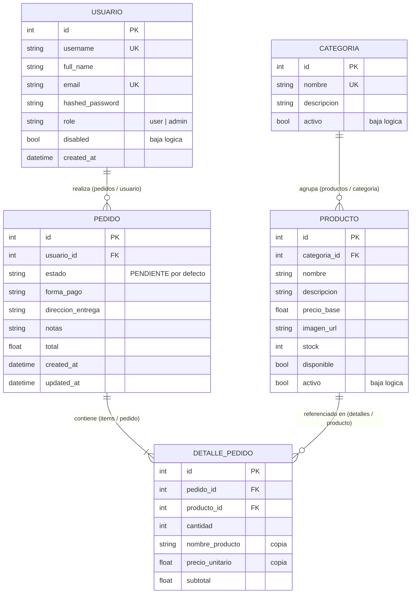

# 00 - Arquitectura: la foto grande

> Objetivo de este documento: que puedas pararte frente al profe y explicar **por qué** el backend está armado así, no solo **cómo**. Los conceptos van primero; el código es la prueba de que los entendiste.

## Cómo usar estos docs para el parcial

El 14/11 no te van a pedir que recites código: te van a preguntar **"¿por qué lo hiciste así?"**. Por eso cada pieza de estos docs (`00`, `01`, `02` y los siguientes) sigue la misma plantilla de cuatro bloques:

| Bloque | Para qué sirve | Cómo estudiarlo |
|---|---|---|
| **Qué hace** | Entender la mecánica paso a paso | Leelo una vez, tiene que sonarte obvio |
| **Por qué lo planteamos así** | La razón de diseño. Siempre distingue entre **"lo exige la consigna"** (con página o criterio) y **"decisión nuestra"** (con la razón técnica) | Es el bloque MÁS importante: tenés que poder explicarlo sin mirar |
| **Alternativa descartada** | Qué otra cosa se podía hacer y por qué acá es peor | Te prepara para la repregunta "¿y por qué no X?" |
| **Si te preguntan en el parcial** | Una respuesta de 1-2 oraciones en primera persona para decir en voz alta | Practicala hablando, no leyendo |

Recomendación de estudio:

1. **Primero los conceptos** (este documento, sección 3): UoW, Repository, genéricos, `Depends`, excepciones de dominio, baja lógica. Si entendés esos seis, el resto es aplicarlos.
2. **Después recorré una request de punta a punta** (sección 6) y tratá de contarla sin mirar.
3. **Distinguí siempre "lo pide la consigna" de "lo decidimos nosotros".** Si el profe pregunta algo que la consigna exige, la respuesta honesta es "lo exige la consigna (pág. X) y además sirve para Y". Si es decisión nuestra, tenés que dar la razón técnica; "porque sí" o "porque me pareció" no sirve.
4. **No memorices código.** Memorizá la *razón*. Con la razón, el código lo reconstruís.
5. Si no sabés algo en el oral, es mejor decir "no lo tengo presente, pero el criterio que seguí fue..." que inventar. Por eso en cada doc hay una nota de **limitaciones conocidas**: conocerlas demuestra que entendés el diseño.

Mapa de la consigna que más vas a citar:

| Qué | Dónde en la consigna |
|---|---|
| Stack y versiones (Python 3.11 a 3.13) | pág. 6-7 |
| Capas y "regla del Unit of Work" | pág. 7 |
| Componentes de `core/` y módulos | pág. 8 |
| Estructura de carpetas | pág. 8-9 |
| Autenticación y autorización (pasos 1 a 5) | pág. 10 |
| Códigos de error comunes y excepciones de dominio | pág. 10-11 |
| Criterios 1, 3 y 4 (estructura, UoW/Repository, auth) | pág. 21 |

---

## 1. Qué es Food Store (en una frase)

Una API REST con **FastAPI + SQLModel** (base PostgreSQL, o SQLite en desarrollo) que maneja usuarios, categorías, productos y pedidos, con **JWT en cookie HttpOnly**, **dos roles** (`user`, `admin`) y una **creación de pedidos transaccional** (o se crea todo o no se crea nada).

Todo cuelga de `/api/v1` (`API_PREFIX` en `app/main.py`) y la documentación automática sale en `/docs` y `/redoc`.

## 2. La arquitectura en capas

Cada módulo de dominio (`app/modules/<dominio>/`) repite la misma cadena:

```
Router  ->  Service  ->  Unit of Work  ->  Repository  ->  Model
(HTTP)      (reglas)     (transacción)     (consultas)     (tablas)
```

Y al lado viven los **schemas** (entrada/salida) y `app/core/` (infraestructura compartida).

| Capa | Archivo | Responsabilidad | Qué NO hace |
|------|---------|-----------------|-------------|
| Router | `router.py` | Recibe HTTP, valida el body con schemas, resuelve sesión/rol con `Depends`, delega al Service y **traduce excepciones de dominio a `HTTPException`** | No tiene reglas de negocio, no abre el UoW, no hace commit |
| Service | `service.py` | Reglas de negocio. Abre `with self.uow as uow:`, aplica reglas y **devuelve el schema de salida dentro del bloque** | No conoce HTTP (no importa `HTTPException` en categorias/productos/pedidos), no llama `session.commit()` |
| Unit of Work | `unit_of_work.py` | Crea la sesión, expone los repositorios que la comparten, **commit o rollback en `__exit__`** | No tiene reglas de negocio |
| Repository | `repository.py` | Consultas con `select`. Hereda de `BaseRepository[T]` | No tiene reglas de negocio ni commit |
| Model | `models.py` | Tablas SQLModel (`table=True`) y relaciones | Nada más |
| Schemas | `schemas.py` | Modelos de entrada/salida (SQLModel **sin** `table=True`) | No son tablas |

### La arquitectura en capas — `app/modules/<dominio>/*`
**Qué hace:** separa cada caso de uso en cinco responsabilidades encadenadas: el Router habla HTTP, el Service decide, el Unit of Work maneja la transacción, el Repository consulta y el Model describe las tablas.
**Por qué lo planteamos así:** **lo exige la consigna** (pág. 7, tabla "Arquitectura en capas", y criterio 1 de la rúbrica: *"Capas mezcladas"* resta puntos). Además tiene una razón técnica propia: cada capa tiene **un solo motivo para cambiar**. Si cambia el protocolo (HTTP), tocás el Router; si cambia una regla de negocio, tocás el Service; si cambia la base de datos, tocás Repository/engine.
**Alternativa descartada:** poner todo en el endpoint (consulta, regla, commit y respuesta en la misma función). Para un TP chico andaría, pero no se puede testear la regla sin levantar HTTP, no se puede reusar la lógica desde un script (como el seed) y cualquier cambio toca todo.
**Si te preguntan en el parcial:** "Separé en capas porque la consigna lo pide, pero además porque cada capa cambia por una razón distinta: la regla de negocio no tiene por qué enterarse de si le hablan por HTTP o desde un script."

### Dependencias unidireccionales

Cada capa solo conoce a la de abajo. El Router importa el Service; el Service importa el UoW y los schemas; el UoW importa los repositorios; el repositorio importa el modelo. **Nunca al revés**: un repositorio no sabe que existe un Service.

**Por qué importa:** si mañana cambiás FastAPI por otro framework, tocás solo los routers. Si cambiás de base, tocás solo repositorios/engine. Las reglas de negocio (el corazón) quedan intactas. Es la idea de Arquitectura Hexagonal/Clean: el dominio no depende de la infraestructura.

**Alternativa descartada:** que los repositorios llamen a servicios o que el Service importe cosas de FastAPI. Genera imports circulares y acopla las reglas al framework.

**Honestidad técnica (por si te preguntan):** hay un par de acoplamientos pragmáticos que conviene conocer y saber defender:
- `app/core/deps.py` importa de `app.modules.usuarios` (schema `UserPublic` y `UsuarioUnitOfWork`) porque para saber quién es el usuario necesita cargarlo. Es la única violación "hacia arriba" de `core/`. La consigna ubica `deps.py` en `core/` (pág. 8) y a la vez le pide que cargue el usuario, así que el acoplamiento es inevitable.
- Los services importan excepciones de otros services: `pedidos/service.py` importa `ProductoNoEncontrado` de `productos/service.py`, y `productos/service.py` importa `CategoriaNoEncontrada` de `categorias/service.py`. Es reutilización de excepciones de dominio, no de lógica: decidimos no duplicar la misma excepción en dos módulos.
- `PedidoUnitOfWork` importa `ProductoRepository` (necesita tocar stock en la misma sesión). Esto lo pide la consigna (pág. 8: "su Unit of Work expone los repositorios de pedidos y productos").

---

## 3. Conceptos clave

### 3.1 Unit of Work (UoW) — `app/core/unit_of_work.py`

**Problema:** un caso de uso (crear un pedido) toca varias tablas: inserta un `Pedido`, N `DetallePedido` y modifica el `stock` de N productos. Si algo falla a la mitad, no puede quedar un pedido sin líneas o stock descontado sin pedido.

**Solución:** el Unit of Work representa **una transacción de negocio**. Abre una sesión al entrar al `with`, y al salir decide: sin excepción -> `commit`; con excepción -> `rollback`. En ambos casos `close`.

```python
# app/core/unit_of_work.py
def __exit__(self, exc_type, exc_val, exc_tb) -> None:
    try:
        if exc_type:
            self.session.rollback()
        else:
            self.session.commit()
    finally:
        self.session.close()
```

Regla de oro de la consigna: **ningún Service ni Router llama a `session.commit()`**. Los repositorios tampoco: usan `flush()`, que manda el SQL pero no confirma. (Verificado con búsqueda en todo `app/`: el único `.commit()` del proyecto está en `UnitOfWork.__exit__`.)

**Qué hace:** ver arriba; es un context manager (`__enter__`/`__exit__`) que envuelve una transacción.
**Por qué lo planteamos así:** **lo exige la consigna** (pág. 3 y "REGLA DEL UNIT OF WORK" pág. 7; criterio 3: *"commit en Service o Router"* resta). La razón técnica: concentrar el commit en UN solo lugar garantiza atomicidad (todo o nada) y evita que un programador olvide el rollback.
**Alternativa descartada:** hacer `session.commit()` dentro de cada método del Service o del repositorio. Si un caso de uso llama a dos métodos que commitean por separado, la primera mitad ya quedó confirmada cuando falla la segunda: pierde la atomicidad. Para crear un pedido sería inconsistencia de stock.
**Si te preguntan en el parcial:** "Usé Unit of Work para que el commit viva en un solo lugar, el `__exit__`. Así, si cualquier validación lanza una excepción en mitad de la creación del pedido, se hace rollback y no queda ni el pedido ni el stock descontado."

### 3.2 Repository pattern — `app/modules/*/repository.py`

Un repositorio encapsula el **acceso a datos** de una entidad: "dame el producto por id", "buscá productos por nombre". El Service pide cosas al repositorio sin saber SQL. Los repositorios **no tienen reglas de negocio** (por ejemplo `ProductoRepository.search` filtra activos, pero decidir *qué* hacer si no hay stock es del Service).

**Qué hace:** da una interfaz de "colección" sobre una tabla (`get_by_id`, `add`, consultas con nombre propio).
**Por qué lo planteamos así:** **lo exige la consigna** (pág. 7: "Consultas con `select`... Sin reglas de negocio"; criterio 3 resta *"repositorios con reglas de negocio"*). Razón técnica: aislar el SQL en un lugar permite que el Service se lea como lenguaje de negocio y que un cambio de consulta no toque las reglas.
**Alternativa descartada:** hacer `session.exec(select(...))` directo en el Service. Mezcla "qué regla aplico" con "cómo consulto"; las consultas se duplican entre services.
**Si te preguntan en el parcial:** "El repositorio solo sabe consultar; las decisiones, como rechazar por falta de stock, las toma el Service. Lo separé para que si cambia la consulta no se rompa la regla."

### 3.3 Genéricos: `BaseRepository[T]` — `app/core/base_repository.py`

`app/core/base_repository.py` define `T = TypeVar("T", bound=SQLModel)` y `class BaseRepository(Generic[T])`. `T` es "el tipo de modelo". Cada repositorio concreto lo fija:

```python
class CategoriaRepository(BaseRepository[Categoria]):
    model = Categoria
```

Así `get_by_id`, `get_all`, `add` y `delete` se escriben **una sola vez** y el type checker sabe que `CategoriaRepository.get_by_id` devuelve `Categoria | None`. Es DRY + tipado fuerte.

> Gotcha: existe la sintaxis nueva `class X[T: ...]` (PEP 695), pero exige **Python 3.12+**. Como la consigna acepta 3.11 (pág. 6: "Python 3.11 a 3.13"), se usa `TypeVar` + `Generic`, que funciona en 3.11, 3.12 y 3.13.

**Qué hace:** parametriza el repositorio por el tipo de modelo, así el CRUD común se escribe una vez.
**Por qué lo planteamos así:** **la consigna pide `BaseRepository[T]`** (pág. 3, criterio 3). La forma `TypeVar` + `Generic[T]` es **decisión nuestra** porque la sintaxis PEP 695 rompe en Python 3.11 y la consigna permite 3.11.
**Alternativa descartada:** (a) PEP 695 `class BaseRepository[T: SQLModel]`: no corre en 3.11. (b) Escribir `get_by_id` en cada repositorio: código duplicado cuatro veces y sin garantía de consistencia.
**Si te preguntan en el parcial:** "Usé `TypeVar` y `Generic` en vez de la sintaxis nueva con corchetes porque esa exige Python 3.12 y la consigna admite 3.11; así el repositorio base se escribe una vez y cada hijo solo fija el modelo."

### 3.4 Inyección de dependencias con `Depends` — `app/modules/*/router.py`, `app/core/deps.py`

FastAPI construye los objetos que un endpoint necesita *antes* de llamarlo. En vez de hacer `service = PedidoService(...)` dentro del endpoint, declarás el parámetro:

```python
# app/modules/pedidos/router.py
def get_pedido_service() -> PedidoService:
    return PedidoService(PedidoUnitOfWork(session_factory))

ServiceDep = Annotated[PedidoService, Depends(get_pedido_service)]

def crear_pedido(data: PedidoCreate, usuario: CurrentUser, service: ServiceDep): ...
```

Ventajas: el endpoint queda finito, y en tests podés **reemplazar** `get_pedido_service` por uno falso (`app.dependency_overrides`). También encadena: `CurrentUser` depende de `get_current_active_user`, que depende de `get_current_user`.

**Qué hace:** FastAPI resuelve las dependencias (servicio, usuario) y se las pasa al endpoint ya construidas.
**Por qué lo planteamos así:** **lo exige la consigna** para el servicio (pág. 3 y 7: "el Router obtiene el Service con `Depends(get_<modulo>_service)` y nunca abre el Unit of Work") y para sesión/rol (pág. 10). Decisión nuestra: `ServiceDep` como alias `Annotated` para no repetir `Depends(...)` en cada endpoint.
**Alternativa descartada:** instanciar el Service dentro de cada endpoint o usar una variable global. Con global compartís estado entre requests; instanciando adentro no podés sustituirlo en tests.
**Si te preguntan en el parcial:** "Con `Depends` el Router no sabe cómo se construye el Service ni abre el Unit of Work; FastAPI me lo entrega. Eso lo pide la consigna y además me permite reemplazarlo en pruebas."

### 3.5 Excepciones de dominio vs `HTTPException` — `app/modules/*/service.py` y `router.py`

- **Excepción de dominio** (`StockInsuficiente`, `PedidoAjeno`...): hereda de `Exception`, vive en `service.py`, **no sabe de HTTP**. Expresa "pasó algo del negocio".
- **`HTTPException`**: es un concepto de la capa web (código 404, 400...).

El Service lanza la de dominio; el **Router** la captura y la traduce (`_http(error)`). Así el Service se puede reusar desde un script, un test o una cola de mensajes sin arrastrar FastAPI. Tabla de traducción real (`app/modules/pedidos/router.py`):

| Excepción de dominio | HTTP |
|---|---|
| `PedidoNoEncontrado`, `ProductoNoEncontrado` | 404 |
| `PedidoAjeno` | 403 |
| `StockInsuficiente`, `ProductoNoDisponible`, `ProductoRepetido`, `TransicionInvalida`, `PedidoNoCancelable` | 400 |

Y lo importante: **cuando la excepción se propaga fuera del `with`, el UoW hace rollback**. La excepción de dominio es justamente lo que dispara el rollback.

**Qué hace:** el Service expresa errores de negocio con excepciones propias; el Router las convierte al código HTTP correcto.
**Por qué lo planteamos así:** **lo exige la consigna** (pág. 11: "El Service los produce lanzando excepciones de dominio definidas en su `service.py`; el Router las captura con try/except"). Razón técnica: mantiene al Service independiente de HTTP y hace que el rollback sea automático al propagarse la excepción.
**Alternativa descartada:** lanzar `HTTPException` directo desde el Service. La consigna lo tolera solo en auth y usuarios (pág. 11), pero es peor diseño: el Service queda atado a FastAPI. En nuestro caso, auth y usuarios también usan excepciones de dominio, por consistencia.
**Si te preguntan en el parcial:** "El Service lanza excepciones del negocio y el Router las traduce a códigos HTTP. Así las reglas no dependen de FastAPI, y como la excepción sale del `with`, el Unit of Work hace rollback solo."

### 3.6 Baja lógica vs borrado físico (y por qué te lo penalizaron en el TP8) — `BaseRepository.delete`

- **Borrado físico:** `DELETE FROM producto WHERE id = 5`. La fila desaparece.
- **Baja lógica:** `UPDATE producto SET activo = false`. La fila queda, pero la API la trata como inexistente.

**Por qué la consigna exige baja lógica:**
1. **Integridad referencial:** `DetallePedido.producto_id` es FK a `producto`. Borrar físicamente un producto ya vendido rompe la FK (o, peor, borra historial en cascada).
2. **Historial y auditoría:** un negocio necesita saber qué vendió y a quién, aunque el producto ya no exista.
3. **Reversibilidad:** una baja lógica se puede revertir; un `DELETE` no.
4. La rúbrica lo dice textual: en "API de catálogo" resta *"borrado físico"*, y en "Modelo de datos" resta *"pedidos borrables"*. Por eso en el TP8 el borrado físico te costó puntos: es un error de **diseño**, no de sintaxis.

Cómo está implementado: `BaseRepository.delete` NO borra; hace `setattr(obj, campo_baja, valor_baja)`:

- Categoría/Producto: `activo = False` (defaults de `BaseRepository`).
- Usuario: `disabled = True` (`campo_baja = "disabled"` en `UsuarioRepository`).
- Pedido: `campo_baja = None` -> `delete` lanza `NotImplementedError`. **Los pedidos no se borran: se cancelan.**

**Qué hace:** "borrar" marca el registro como inactivo en vez de eliminarlo.
**Por qué lo planteamos así:** **lo exige la consigna** (pág. 3-5: "Baja lógica con un campo booleano; los pedidos no se borran"; criterios 2 y 5). Decisión nuestra: parametrizar el campo y el valor (`campo_baja`/`valor_baja`) en el repositorio base, porque usuario usa `disabled=True` (sentido inverso a `activo=False`) y pedido no admite baja.
**Alternativa descartada:** `session.delete(obj)`. Rompe FK de `DetallePedido` y pierde historial. Otra alternativa descartada: reimplementar `delete` en cada repositorio; duplica código solo para cambiar un nombre de campo.
**Si te preguntan en el parcial:** "Hice baja lógica porque las líneas de pedido apuntan a productos por clave foránea; borrar el producto rompería el historial. El repositorio base lo resuelve con un campo configurable, porque en usuarios es `disabled` y en pedidos directamente no existe."

---

## 4. Diagrama ER (las 5 entidades)



Los nombres entre paréntesis son los atributos `Relationship(back_populates=...)` reales de los modelos (exigidos por la consigna, pág. 9-10: "con estos nombres exactos, porque los schemas de lectura dependen de ellos"): `Categoria.productos`/`Producto.categoria`, `Usuario.pedidos`/`Pedido.usuario`, `Pedido.items`/`DetallePedido.pedido`, `Producto.detalles`/`DetallePedido.producto`.

**Por qué `DetallePedido` copia `nombre_producto` y `precio_unitario`:** **lo exige la consigna** (pág. 4 y criterio 2). Razón técnica: si el admin cambia el precio de un producto mañana, los pedidos viejos no pueden cambiar de total (RN-05, inmutabilidad). La copia "congela" el precio de la venta.
**Alternativa descartada:** leer el precio desde `Producto` al mostrar el pedido. El historial mentiría apenas se edite el precio.
**Si te preguntan en el parcial:** "Copié nombre y precio en la línea del pedido porque el precio del producto puede cambiar después; el pedido tiene que reflejar lo que el cliente realmente pagó."

## 5. Flujo "crear pedido" con Unit of Work

```mermaid
sequenceDiagram
    autonumber
    actor C as Cliente (navegador)
    participant R as Router (pedidos/router.py)
    participant D as deps (get_current_active_user)
    participant S as PedidoService
    participant U as PedidoUnitOfWork
    participant PR as PedidoRepository
    participant PD as ProductoRepository
    participant DB as Base de datos

    C->>R: POST /api/v1/pedidos (cookie access_token + JSON)
    R->>R: valida PedidoCreate (422 si falla: RN-06)
    R->>D: Depends(CurrentUser)
    D-->>R: UserPublic (401 / 400 si corresponde)
    R->>S: service.crear(data, usuario)
    S->>U: with self.uow as uow (__enter__)
    U->>DB: abre Session
    S->>S: valida productos repetidos (ProductoRepetido)
    S->>PR: add(Pedido PENDIENTE, total=0)
    PR->>DB: INSERT pedido (flush)
    loop por cada item
        S->>PD: get_para_actualizar(producto_id)
        PD->>DB: SELECT ... FOR UPDATE
        S->>S: valida activo / disponible / stock
        S->>S: producto.stock -= cantidad
        S->>S: crea DetallePedido con nombre_producto, precio_unitario, subtotal
        S->>S: acumula total
    end
    S->>PR: pedido.total = suma; add(pedido)
    S->>S: PedidoRead.model_validate(pedido) (DENTRO del with)
    alt sin excepcion
        S->>U: __exit__ sin error
        U->>DB: COMMIT + close
        S-->>R: PedidoRead
        R-->>C: 201 Created
    else excepcion de dominio
        S->>U: __exit__ con error
        U->>DB: ROLLBACK + close (stock intacto, sin pedido)
        S-->>R: propaga la excepcion
        R-->>C: 404 / 400 (HTTPException)
    end
```

(El detalle de este flujo se explica en el doc de pedidos; acá importa ver que **todo** pasa entre el `__enter__` y el `__exit__` del mismo UoW.)

## 6. Una request de punta a punta

Ejemplo: `PATCH /api/v1/pedidos/7/cancelar` de un cliente.

1. **Navegador** manda la cookie `access_token` (HttpOnly) automáticamente (el frontend usa `withCredentials`).
2. **CORS middleware** (`app/main.py`) verifica el origen (`settings.FRONTEND_ORIGIN`) y permite credenciales.
3. **Ruteo:** `main.py` incluyó `pedidos_router` con prefijo `/api/v1`; el router tiene prefijo `/pedidos`; el endpoint `/{id}/cancelar`.
4. **Validación de path:** `PedidoId = Annotated[int, Path(gt=0)]` -> 422 si `id <= 0`.
5. **Dependencias:** `CurrentUser` -> `get_current_active_user` -> `get_current_user` (lee cookie, decodifica JWT, carga usuario con su propio UoW) -> 401/400 si no pasa. `ServiceDep` -> `get_pedido_service()`.
6. **Endpoint** llama `service.cancelar(id, usuario)` dentro de `try/except ERRORES_DOMINIO`.
7. **Service** abre `with self.uow`, busca el pedido, valida dueño y estado, restituye stock, cambia estado, arma `PedidoRead`.
8. **UoW `__exit__`:** commit (o rollback si algo explotó).
9. **Router** devuelve el `PedidoRead` (filtrado por `response_model`) o traduce la excepción a `HTTPException`.

**Por qué lo planteamos así:** el orden (CORS, validación, dependencias, endpoint) lo impone FastAPI/Starlette; lo que es **decisión nuestra** es que la autenticación esté como dependencia y no dentro del endpoint, para que ningún endpoint se "olvide" de chequear sesión. **Si te preguntan en el parcial:** "Cuando llega una request, primero pasa CORS, después FastAPI valida el path y resuelve las dependencias (sesión, rol, servicio), y recién ahí corre mi endpoint, que delega al Service. El commit lo hace el Unit of Work al salir del `with`."

## 7. Estructura de carpetas (real)

```
backend/
  app/
    main.py                  # FastAPI, CORS, routers, lifespan
    core/
      config.py              # Settings (.env)
      database.py            # engine, create_all_tables, session_factory
      security.py            # bcrypt + JWT
      deps.py                # get_current_user, get_current_active_user, require_role
      unit_of_work.py        # UnitOfWork base
      base_repository.py     # BaseRepository[T]
    modules/
      auth/        router, service, schemas        (usa el modelo Usuario)
      usuarios/    models, schemas, repository, unit_of_work, service, router
      categorias/  idem
      productos/   idem
      pedidos/     idem (Pedido + DetallePedido)
    db/seed.py               # carga inicial idempotente
  http/*.http                # pruebas manuales (REST Client)
  .env.example               # variables de entorno de ejemplo
  requirements.txt
```

**Por qué una carpeta por dominio ("screaming architecture") y no una carpeta por tipo de archivo (`routers/`, `services/`, `models/`):** la estructura **la pide la consigna** (pág. 8-9, criterio 1: "Módulos por dominio con las capas y los componentes del núcleo"). Razón propia: al abrir `modules/` ya se ve de qué trata el sistema (usuarios, productos, pedidos), y todo lo que cambia junto vive junto.
**Alternativa descartada:** agrupar por tipo técnico. Para tocar "pedidos" tenés que saltar entre cuatro carpetas.
**Si te preguntan en el parcial:** "Organicé por dominio porque lo que cambia junto tiene que vivir junto: si cambia pedidos, abro `modules/pedidos` y está todo."

## 8. Decisiones que conviene saber defender

### Los schemas de salida se construyen dentro del `with`
**Qué hace:** `PedidoRead.model_validate(pedido)` se ejecuta antes de que termine el bloque `with`.
**Por qué lo planteamos así:** **lo exige la consigna** (pág. 7 y 15: "devuelve el schema de salida dentro del bloque"). Razón técnica: después del commit, SQLAlchemy "expira" los objetos y, al cerrar la sesión, quedan desligados; leer atributos fallaría (`DetachedInstanceError`).
**Alternativa descartada:** devolver el objeto de tabla y dejar que FastAPI lo serialice afuera: se rompe por la sesión cerrada y además expone campos internos.
**Si te preguntan en el parcial:** "Convierto a schema adentro del `with` porque al salir la sesión se cierra y el objeto ORM ya no puede leer sus atributos."

### Nunca se devuelve un modelo de tabla como respuesta
**Qué hace:** siempre se responde con un schema (`UserPublic`, `PedidoRead`...).
**Por qué lo planteamos así:** **lo exige la consigna** (pág. 14: "Nunca se expone un modelo de tabla como respuesta"). Razón técnica: así no se filtra `hashed_password` y el contrato de la API es explícito y estable aunque cambie la tabla.
**Alternativa descartada:** `response_model=Usuario` (la tabla): expondría el hash de contraseña.
**Si te preguntan en el parcial:** "El schema de salida es el contrato de la API; la tabla es un detalle interno. Por eso `UserPublic` no tiene `hashed_password`."

### `flush()` en el repositorio (en `add`)
**Qué hace:** manda el INSERT/UPDATE a la base dentro de la transacción, sin confirmarlo.
**Por qué lo planteamos así:** **decisión nuestra**. Hace que el `id` autogenerado esté disponible dentro de la transacción (necesitamos el `id` del pedido para crear sus líneas) sin que el repositorio commitee, cumpliendo la regla del UoW.
**Alternativa descartada:** `commit()` en el repositorio (viola la regla) o no hacer `flush` (el `id` sería `None` hasta el commit).
**Si te preguntan en el parcial:** "Uso `flush` porque necesito el id generado antes de terminar, pero el commit sigue siendo solo del Unit of Work."

### Creación de tablas con `create_all` en el `lifespan` (sin Alembic)
**Qué hace:** al arrancar, crea las tablas que falten.
**Por qué lo planteamos así:** **decisión nuestra**: es simple y suficiente para un TP; la consigna pide `create_all_tables` en `database.py` (pág. 8) y no menciona migraciones.
**Alternativa descartada:** Alembic. Es lo correcto en producción, pero agrega complejidad y no migra solo con `create_all`: este no modifica tablas existentes.
**Si te preguntan en el parcial:** "Usé `create_all` porque el alcance es un TP; en producción usaría migraciones con Alembic, porque `create_all` no altera tablas ya creadas."
