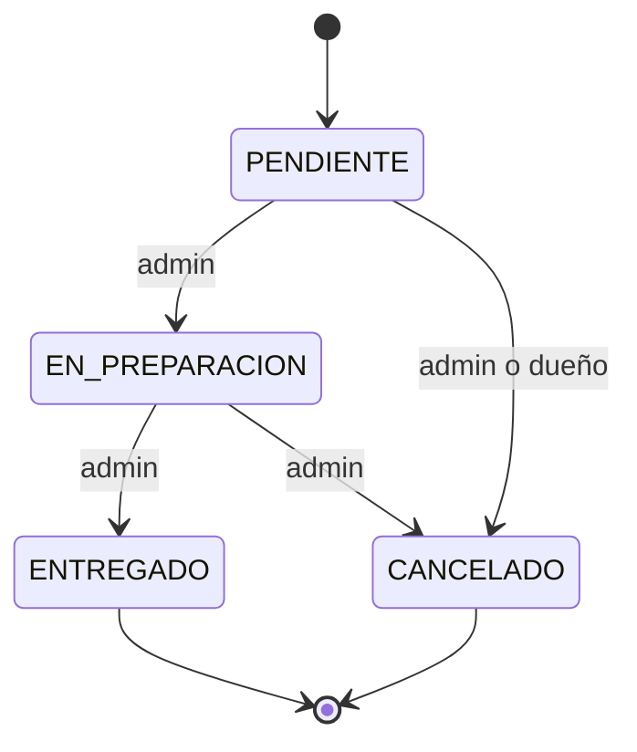

# 04 - Pedidos: el corazón del TP

Archivos: `app/modules/pedidos/{models,schemas,repository,unit_of_work,service,router}.py`. Las referencias de línea son de `service.py` salvo que se indique otro archivo.

> **Cómo leer este doc para el parcial:** cada entrada tiene **Qué hace**, **Por qué lo planteamos así** (marcando si *lo exige la consigna* o es *decisión nuestra*), **Alternativa descartada** y **Si te preguntan en el parcial**. Pedidos es el criterio de más peso (15 puntos, criterio 6 de la consigna, pág. 22): "Reglas faltantes, stock inconsistente, cambios de estado sin validar" es lo que resta. Todo el diseño apunta a esas tres cosas.

---

## 1. Modelos (`models.py`)

### `ahora() -> datetime` — `pedidos/models.py`
**Qué hace:** devuelve `datetime.now(timezone.utc)`; es el `default_factory` de `created_at` y `updated_at`.
**Por qué lo planteamos así:** *decisión nuestra*: guardamos **todas las fechas en UTC** para que no dependan de la zona horaria del servidor. Es una función (`default_factory`) y no un valor fijo, para que se evalúe **en cada instancia**; con `default=datetime.now()` todas tendrían la hora en que arrancó el servidor.
**Alternativa descartada:** `datetime.now()` sin zona (hora local): ambigua en horario de verano y si el servidor cambia de región.
**Si te preguntan en el parcial:** "Guardo todo en UTC y paso una función como `default_factory` para que la fecha se calcule en cada creación, no una sola vez al importar el módulo."

### `Pedido(SQLModel, table=True)` — `pedidos/models.py`
**Qué hace:** tabla `pedido`: `id`, `usuario_id` (FK `usuario.id`, indexado), `estado` (default `"PENDIENTE"`, indexado), `forma_pago`, `direccion_entrega`, `notas`, `total` (default 0), `created_at`, `updated_at` (ambos `DateTime(timezone=True)`). **No tiene campo de baja.** Relaciones: `usuario` <-> `Usuario.pedidos`; `items` <-> `DetallePedido.pedido` con `order_by: "DetallePedido.id"`.
**Por qué lo planteamos así:** los campos, el default `PENDIENTE` y "no se borra: se cancela" *los exige la consigna* (pág. 5, tabla de entidades; RN-05). La ausencia de campo `activo` es **deliberada**: el criterio 2 resta por "pedidos borrables". `estado` es un `str` (no un `Enum` de base) porque la consigna dice que los valores permitidos se validan en schemas y Service, sin `CHECK` (pág. 4); la validación la hace el `Literal` `EstadoPedido` y el mapa de transiciones. Indexamos `estado` porque el listado filtra por estado y el resumen agrupa por estado; `usuario_id` porque "mis pedidos" filtra por dueño. `DateTime(timezone=True)` guarda la zona en PostgreSQL. El `order_by` de `items` hace que las líneas salgan siempre en el orden en que se crearon.
**Alternativa descartada:** campo `activo` en Pedido con `DELETE` lógico: contradice RN-05 ("no hay endpoint de borrado") y mezcla "cancelado" con "borrado". `Enum` de SQL: acopla el modelo a la base y la consigna pide validar en código.
**Si te preguntan en el parcial:** "El pedido no tiene baja porque un pedido es un registro contable: no se borra, se cancela, y eso queda reflejado en el estado. Indexé `estado` y `usuario_id` porque son los filtros más usados."

### `DetallePedido(SQLModel, table=True)` — `pedidos/models.py`
**Qué hace:** línea del pedido: `id`, `pedido_id` (FK), `producto_id` (FK), `cantidad` (`ge=1`), **`nombre_producto`**, **`precio_unitario`**, `subtotal`. Relaciones: `pedido` <-> `Pedido.items`; `producto` <-> `Producto.detalles`.
**Por qué lo planteamos así:** *lo exige la consigna* ("Línea inmutable con copia del nombre y del precio", pág. 5; RN-05; criterio 2). **Patrón snapshot:** si la línea guardara solo `producto_id` y leyera el precio del producto, cuando el admin suba la pizza de $9.500 a $12.000 **todos los pedidos viejos cambiarían de monto**: el historial contable se corrompe y un pedido ya entregado "valdría" otra cosa. Lo mismo si renombran o dan de baja el producto. Copiar nombre y precio al momento de la compra los **congela**. La FK `producto_id` se mantiene solo para trazabilidad ("de qué producto vino") y para poder restituir el stock al cancelar. También guardamos `subtotal` (precio × cantidad) para que el total del pedido y los reportes no dependan de recalcular.
**Alternativa descartada:** guardar solo `producto_id` y hacer JOIN para mostrar nombre y precio: es la estructura "normalizada pura", pero el historial cambia cuando cambia el catálogo. Es justamente lo que el criterio 2 llama "líneas sin copia de precio".
**Si te preguntan en el parcial:** "Copio nombre y precio en la línea para que el pedido sea una foto del momento de la compra; si mañana cambia el precio del producto, los pedidos viejos no se alteran. La FK queda para trazabilidad y para devolver stock."

---

## 2. Schemas (`schemas.py`)

### `EstadoPedido` y `FormaPago` (`Literal`) — `pedidos/schemas.py`
**Qué hacen:** `EstadoPedido = Literal["PENDIENTE", "EN_PREPARACION", "ENTREGADO", "CANCELADO"]`; `FormaPago = Literal["EFECTIVO", "TRANSFERENCIA"]`.
**Por qué lo planteamos así:** la consigna define esos valores (pág. 5 y RN-06) y pide validarlos en el schema. Con `Literal`, Pydantic rechaza cualquier otro valor con **422** antes de llegar al Service (por ejemplo `"ENVIADO"`; `.http` #39). Además aparece en la documentación OpenAPI como lista de valores.
**Alternativa descartada:** `str` + `if forma_pago not in (...)` en el Service: validación duplicada y a mano. `Enum` de Python: funciona, pero el `Literal` es más liviano y los valores quedan como strings planos en JSON y en la base.
**Si te preguntan en el parcial:** "Uso `Literal` para que Pydantic valide los valores permitidos y devuelva 422 automáticamente; así el Service ya recibe datos válidos."

### `_como_utc(valor)` y `FechaUTC` — `pedidos/schemas.py`
**Qué hacen:** si la fecha viene sin zona (`tzinfo is None`), le asigna UTC; `FechaUTC = Annotated[datetime, AfterValidator(_como_utc)]` la aplica en `created_at` y `updated_at` de `PedidoRead`.
**Por qué lo planteamos así:** *decisión nuestra*: SQLite devuelve las fechas **sin zona** aunque las guardamos en UTC, y PostgreSQL con `timezone=True` sí las devuelve con zona. Para que el JSON salga igual en ambas bases (con `Z`/`+00:00`) y el frontend no interprete la hora como local, las marcamos explícitamente como UTC.
**Alternativa descartada:** dejar la fecha tal cual salga de la base: en SQLite el frontend vería una hora "ingenua" y la mostraría corrida.
**Si te preguntan en el parcial:** "SQLite pierde la zona horaria; como yo guardo siempre en UTC, la restituyo en el schema de salida para que el frontend reciba la misma fecha con cualquier base."

### `ItemPedidoCreate` — `pedidos/schemas.py`
**Qué hace:** una línea del carrito: `producto_id > 0` y `cantidad >= 1`.
**Por qué lo planteamos así:** *lo exige la consigna* (pág. 14: "cantidad >= 1"). Evita cantidades 0 o negativas, que **sumarían stock** al descontar (`stock -= -3`). Se corta con 422 (`.http` #17).
**Alternativa descartada:** validar cantidad en el Service: tarde y repetido; el schema es el primer filtro.
**Si te preguntan en el parcial:** "La cantidad mínima 1 en el schema evita que una cantidad negativa termine sumando stock al 'descontar'."

### `PedidoCreate` — `pedidos/schemas.py`
**Qué hace:** body del POST: `items` (`min_length=1`), `forma_pago`, `direccion_entrega` (5 a 200 caracteres) y `notas` opcional (max 500).
**Por qué lo planteamos así:** *lo exige la consigna*: RN-06 ("se validan en el schema"), RN-01 ("al menos un ítem") y la tabla de schemas (pág. 14). **Acá se implementa RN-06.** Notar que el body **no trae `usuario_id`**: el dueño sale de la sesión (`CurrentUser`), nunca del cliente; si lo aceptáramos, un usuario podría crear pedidos a nombre de otro. Tampoco trae `estado` ni `total`: los calcula el servidor (RN-05).
**Alternativa descartada:** aceptar `total` o `precio` desde el cliente: el cliente podría mandar un precio manipulado. El precio siempre se lee de la base.
**Si te preguntan en el parcial:** "El pedido no recibe ni usuario, ni estado, ni total ni precios del cliente: todo eso lo calcula el servidor. Lo único que viene del cliente son los ids, cantidades, forma de pago y dirección, y se validan en el schema."

### `CambioEstado` — `pedidos/schemas.py`
**Qué hace:** `{estado: EstadoPedido}`, el body del `PATCH /estado`.
**Por qué lo planteamos así:** *lo exige la consigna* ("Uno de los cuatro estados", pág. 15). Un estado inexistente da 422; uno existente pero no permitido desde el actual lo decide el mapa de transiciones y da 400.
**Alternativa descartada:** aceptar `str` libre: habría que validar el nombre a mano además de la transición.
**Si te preguntan en el parcial:** "El schema valida que el estado exista (422) y el Service valida que la transición sea legal (400): son dos validaciones de naturaleza distinta."

### `DetallePedidoRead`, `PedidoRead`, `PedidosPaginados`, `ResumenPedidos` — `pedidos/schemas.py`
**Qué hacen:** schemas de salida. `PedidoRead` incluye `items: list[DetallePedidoRead]`; `PedidosPaginados` es `{total, items}`; `ResumenPedidos` tiene `pendientes, en_preparacion, entregados, cancelados, pedidos_hoy, ingresos_entregados`.
**Por qué lo planteamos así:** *los exige la consigna* (págs. 14-15). Nunca devolvemos el modelo de tabla. `DetallePedidoRead` no incluye `id` ni `pedido_id` porque la consigna no los pide y el cliente no los necesita.
**Alternativa descartada:** devolver `Pedido` directo: expondría la estructura interna y fallaría fuera de la sesión por el lazy loading de `items`.
**Si te preguntan en el parcial:** "Son DTOs de salida: lo que la API promete devolver, desacoplado de la estructura de la tabla."

---

## 3. Repositorio (`repository.py`)

### `PedidoRepository(BaseRepository[Pedido])` y `campo_baja = None` — `pedidos/repository.py`
**Qué hace:** hereda el CRUD genérico y fija `campo_baja = None`, de modo que `delete()` lanza `NotImplementedError`.
**Por qué lo planteamos así:** *RN-05 / criterio 2*: "pedidos borrables" resta. Con `campo_baja = None` el `BaseRepository` se niega a borrar: **a nivel de código no se puede borrar un pedido ni lógicamente**; no es solo que falte el endpoint. Es una segunda barrera.
**Alternativa descartada:** heredar el `delete` por defecto: intentaría poner `activo = False` sobre un campo que Pedido no tiene: en el mejor caso un error confuso, en el peor un "borrado" que no borra nada.
**Si te preguntan en el parcial:** "Pongo `campo_baja = None` para que el repositorio de pedidos directamente no sepa borrar. Así la regla 'los pedidos no se borran' está en el código, no solo en que falte un endpoint."

### `list_by_usuario(self, usuario_id, skip=0, limit=20, estado=None) -> tuple[int, Sequence[Pedido]]` — `pedidos/repository.py`
**Qué hace:** arma los filtros (dueño si `usuario_id` no es `None`, y estado si viene), cuenta el total con esos filtros y trae la página con `selectinload(Pedido.items)`, ordenada por `created_at desc, id desc`.
**Por qué lo planteamos así:** consigna: `GET /pedidos` devuelve "Propios (user) o todos (admin)" con `skip, limit, estado` (pág. 13). Un mismo método sirve a ambos roles: el admin pasa `usuario_id=None` (sin filtro de dueño). **El filtro por dueño va en la consulta SQL, no en memoria**: es más eficiente y, sobre todo, más seguro (un pedido ajeno ni siquiera sale de la base). `selectinload(items)` evita el N+1: `PedidoRead` lee las líneas de cada pedido. `created_at desc, id desc`: lo más nuevo primero; el `id` desempata pedidos con el mismo timestamp y hace la paginación estable. Devolvemos `(total, página)` igual que en productos.
**Alternativa descartada:** traer todos los pedidos y filtrar por usuario en Python (lento y riesgoso); lazy loading de `items` (N+1).
**Si te preguntan en el parcial:** "Filtro por dueño en la consulta y no en memoria, precargo las líneas con `selectinload` para evitar el N+1, y ordeno por fecha descendente con el id como desempate para que la paginación sea estable."

### `count_by_estado(self) -> dict[str, int]` — `pedidos/repository.py`
**Qué hace:** `select(Pedido.estado, func.count(Pedido.id)).group_by(Pedido.estado)` y lo devuelve como `{estado: cantidad}`.
**Por qué lo planteamos así:** la consigna dice "Conteos con `func.count`" (pág. 15). Una sola consulta agregada cuenta los cuatro estados; la alternativa (traer los pedidos y contar en Python) mueve filas innecesarias. Un estado sin pedidos **no aparece** en el resultado (el `GROUP BY` no genera filas vacías), por eso el Service usa `.get(estado, 0)`.
**Alternativa descartada:** cuatro consultas `COUNT` (una por estado): más viajes a la base.
**Si te preguntan en el parcial:** "Cuento en la base con `GROUP BY`, una sola consulta, y en el Service uso `.get(..., 0)` porque los estados sin pedidos no vienen en el resultado."

### `sum_total_by_estado(self, estado: str) -> float` — `pedidos/repository.py`
**Qué hace:** `select(func.coalesce(func.sum(Pedido.total), 0)).where(Pedido.estado == estado)` y lo convierte a `float`.
**Por qué lo planteamos así:** la consigna define `ingresos_entregados` como "suma de total de los pedidos ENTREGADO" (pág. 15). **Por qué `coalesce`:** `SUM` sobre cero filas devuelve `NULL` (`None` en Python), no 0; sin el `coalesce`, `float(None)` explotaría con `TypeError` cuando todavía no hay pedidos entregados. `coalesce(x, 0)` dice "si es NULL, usá 0". Se suma en la base, no en Python.
**Alternativa descartada:** traer los pedidos ENTREGADO y sumar en Python (`sum(p.total for p in ...)`): más datos viajando; o chequear `None` después en el Service (funciona, pero el `coalesce` lo resuelve en la propia consulta).
**Si te preguntan en el parcial:** "Uso `coalesce` porque `SUM` de cero filas devuelve NULL, no cero; sin eso el resumen se rompería cuando todavía no hay pedidos entregados."

### `count_desde(self, desde: datetime) -> int` — `pedidos/repository.py`
**Qué hace:** cuenta pedidos con `created_at >= desde`.
**Por qué lo planteamos así:** es la base de `pedidos_hoy`. Recibe el instante de corte ya calculado: el repositorio solo consulta, **la definición de "hoy" es lógica del Service**.
**Alternativa descartada:** calcular "hoy" dentro del repositorio: mezclaría regla de negocio con acceso a datos (el criterio 3 lo penaliza).
**Si te preguntan en el parcial:** "El repositorio solo cuenta desde una fecha; decidir qué significa 'hoy' es del Service."

---

## 4. Unit of Work (`unit_of_work.py`)

### `PedidoUnitOfWork._init_repositories(self)` — `pedidos/unit_of_work.py`
**Qué hace:** crea `self.pedidos` y `self.productos` sobre la **misma sesión**.
**Por qué lo planteamos así:** es la clave de la **atomicidad**: el `INSERT` del pedido, los `INSERT` de las líneas y el `UPDATE` del stock viajan en **una sola transacción**. Si cualquiera falla, `__exit__` hace `rollback` y no queda nada a medias. Lo exige la consigna (RN-01: "Todo ocurre en una sola transacción", RN-03 y criterio 6: "stock descontado y restituido en la misma transacción").
**Alternativa descartada:** que pedidos llame al *Service* de productos (cada uno con su propio UoW y su sesión): el stock se confirmaría aunque el pedido fallara después. Ese es el bug clásico de "stock inconsistente".
**Si te preguntan en el parcial:** "Pedidos y productos comparten la misma sesión, o sea la misma transacción. Por eso si falla la línea 3, el rollback deshace también el descuento de stock de las líneas 1 y 2."

---

## 5. Excepciones de dominio y máquina de estados

### `TRANSICIONES` — `pedidos/service.py` (líneas 19-24)
```python
TRANSICIONES: dict[str, set[str]] = {
    "PENDIENTE": {"EN_PREPARACION", "CANCELADO"},
    "EN_PREPARACION": {"ENTREGADO", "CANCELADO"},
    "ENTREGADO": set(),
    "CANCELADO": set(),
}
```

**Qué hace:** mapa "estado actual -> conjunto de estados permitidos". La pregunta "¿es válida A -> B?" es `B in TRANSICIONES[A]`.
**Por qué lo planteamos así:** *lo exige la consigna*: "El mapa de transiciones vive en el Service de pedidos como un diccionario; toda transición se valida antes de modificar el pedido" (pág. 5; RN-02). Un diccionario de sets es **datos, no código**: agregar un estado es agregar una entrada, no tocar una cascada de `if/elif`; la búsqueda en un set es O(1); y los estados terminales tienen `set()` vacío, así que "desde un terminal no se puede ir a ningún lado" sale gratis, sin un `if` especial. Vive en el **Service** (no en el modelo ni en el Router) porque es una regla de negocio; el Router no debe conocerla y el modelo es solo estructura de datos.
**Alternativa descartada:** una cadena de `if estado == "PENDIENTE" and nuevo in (...)`: se llena de ramas, es fácil olvidarse un caso y no se puede inspeccionar como dato. Otra: un `Enum` con método `puede_ir_a`: válido, pero más ceremonia para cuatro estados.
**Si te preguntan en el parcial:** "Modelé la máquina de estados como un diccionario de conjuntos en el Service. Es declarativo: agregar un estado no toca la lógica, los terminales tienen un set vacío y validar es una sola pregunta, `nuevo in TRANSICIONES[actual]`."

### Excepciones de dominio — `pedidos/service.py`
Todas heredan de `Exception` y arman su mensaje en `__init__`.

| Excepción | Mensaje | HTTP |
|---|---|---|
| `PedidoNoEncontrado(id)` | "Pedido {id} no encontrado" | 404 |
| `ProductoNoEncontrado(id)` (importada de productos) | "Producto {id} no encontrado" | 404 |
| `PedidoAjeno()` | "No tenés permiso para acceder a este pedido" | 403 |
| `ProductoRepetido(producto_id)` | "El producto X está repetido en el pedido" | 400 |
| `ProductoNoDisponible(nombre)` | "El producto 'X' no está disponible" | 400 |
| `StockInsuficiente(nombre, stock, pedido)` | "Stock insuficiente para 'X': disponible N, solicitado M" | 400 |
| `TransicionInvalida(actual, nuevo)` | "Transición inválida: A -> B" | 400 |
| `PedidoNoCancelable(estado)` | "Solo se puede cancelar un pedido PENDIENTE (estado actual: X)" | 400 |

**Por qué excepciones de dominio y no `HTTPException` en el Service:** *lo exige la consigna* (pág. 11): "El Service los produce lanzando excepciones de dominio definidas en su service.py; el Router las captura con try/except y responde el código". Razones técnicas: (1) el Service no depende de FastAPI/HTTP, así que se puede reutilizar y testear sin levantar un servidor; (2) una **excepción lanzada dentro del `with`** dispara el `rollback` del Unit of Work y luego se propaga al Router: el mismo mecanismo sirve para deshacer la transacción y para responder el error; (3) cada excepción tiene su propia clase, por lo que el Router puede mapear tipo -> código en un solo lugar. Los mensajes tienen datos útiles ("disponible 3, solicitado 5") para que el frontend los muestre. `ProductoNoEncontrado` se importa del módulo productos en vez de redefinirse (mismo concepto, y se reexporta con `__all__`).
**Alternativa descartada:** `raise HTTPException(400, ...)` en el Service: acopla negocio con HTTP. La consigna lo admite solo en auth/usuarios.
**Si te preguntan en el parcial:** "El Service lanza excepciones de negocio y el Router las traduce a HTTP. Así la lógica no sabe de HTTP, y como la excepción sale del `with`, el Unit of Work hace rollback antes de responder."

### `_ahora() -> datetime` — `pedidos/service.py`
**Qué hace:** `datetime.now(timezone.utc)`, usado para `updated_at` al cambiar de estado.
**Por qué lo planteamos así:** misma razón que `ahora()` del modelo: todo en UTC. `updated_at` **no** se actualiza solo (SQLModel no tiene "on update" automático acá), por eso lo seteamos a mano en `_transicionar`.
**Alternativa descartada:** `onupdate` de SQLAlchemy: funciona, pero lo explícito deja a la vista en el código cuándo cambia.
**Si te preguntan en el parcial:** "`updated_at` lo actualizo a mano en cada cambio de estado, siempre en UTC."

---

## 6. `PedidoService` — función por función

### `crear(self, data: PedidoCreate, usuario: UserPublic) -> PedidoRead` (líneas 74-120) — RN-01
**Qué hace**, paso a paso:
1. **L75** `with self.uow as uow:` abre la transacción.
2. **L76-79** detecta repetidos:
   ```python
   ids = [item.producto_id for item in data.items]
   for producto_id in ids:
       if ids.count(producto_id) > 1:
           raise ProductoRepetido(producto_id)
   ```
3. **L81-90** crea el `Pedido` en `PENDIENTE` con `total=0` y lo guarda con `add` (que hace `flush`).
4. **L93-115** por cada ítem, **en la misma iteración**: `get_para_actualizar` (`FOR UPDATE`), verifica existe/activo (404), disponible (400) y stock (400); descuenta `producto.stock -= cantidad`; calcula `subtotal = round(precio_base * cantidad, 2)`; agrega el `DetallePedido` copiando nombre y precio; acumula `total`.
5. **L117-118** `pedido.total = round(total, 2)` y `add`.
6. **L120** `return PedidoRead.model_validate(pedido)` **dentro del `with`**; al salir, `__exit__` hace `commit`.

**Por qué lo planteamos así**, decisión por decisión:
- **Repetidos antes de tocar la base (L76-79):** *RN-01 lo exige* ("ningún producto repetido", 400). Se valida primero porque es una validación **barata, sin base de datos**: si el carrito es inválido no hace falta abrir bloqueos ni insertar nada. Un producto repetido generaría dos líneas del mismo producto con cantidades separadas, algo ambiguo para el historial; el frontend debe sumar las cantidades en una sola línea. (`ids.count` es O(n²) pero un carrito tiene pocos ítems.)
- **Verificar + descontar + crear la línea en la MISMA iteración:** *lo exige la consigna literalmente* ("Por cada ítem, en la misma iteración, se verifica el stock, se descuenta y se crea la línea", RN-01). La razón técnica: el chequeo y el descuento tienen que verse como **una operación**. Si primero verificaras todos los ítems y después descontaras en otro bucle, entre una fase y otra el estado cambiaría (otra request, o el mismo carrito con duplicados) y la verificación quedaría desactualizada. Con una sola pasada, y con el producto bloqueado, lo que verificás es lo que descontás.
- **`flush` al crear el pedido (por `add`):** manda el `INSERT` **dentro de la transacción** (sin commitear) para que el pedido ya tenga `id`. Lo necesitamos para que las líneas se enlacen por FK y para devolver `PedidoRead.id`. Seguimos el flujo de la consigna (pág. 15: paso 2 `INSERT` con total 0 y paso 4 `UPDATE` del total). El `flush` **no** es `commit`: si después falla algo, el `rollback` lo deshace igual.
- **`FOR UPDATE` (`get_para_actualizar`):** evita el *lost update* — dos pedidos simultáneos que leen `stock = 1` y los dos lo venden. Con el bloqueo, el segundo espera a que el primero termine y recién ahí lee el stock actualizado. **Solo aplica en PostgreSQL**; en SQLite se ignora (por eso en desarrollo local con SQLite no hay protección de concurrencia real). La consigna menciona `get_by_id` en su flujo; usar `get_para_actualizar` es una mejora nuestra para cumplir "stock consistente".
- **Orden de las validaciones por ítem:** primero existe/activo (404), después disponible (400), después stock (400): del error más "estructural" al más "de cantidad", y coincide con los códigos de la consigna (pág. 13).
- **Snapshot de `nombre_producto` y `precio_unitario` (RN-05):** el pedido queda inmutable aunque el producto cambie después. El precio sale **siempre de la base** (`producto.precio_base`), nunca del cliente.
- **`round(..., 2)`:** los montos son `float` (lo fija la consigna) y los floats acumulan errores (`0.1 + 0.2`); redondeamos a centavos cada subtotal y el total.
- **`PedidoRead.model_validate` dentro del `with`:** tras el commit el objeto queda expirado y desligado (ver sección 10).
- **El rollback es total:** una excepción en cualquier ítem sale del `with` y `__exit__` hace `rollback`: se deshacen el pedido, las líneas y los descuentos ya hechos (ver sección 8).
**Alternativa descartada:** (a) validar todos los ítems en un bucle y descontar en otro, (b) hacer `commit` por ítem (si falla el tercero, el stock de los dos primeros queda descontado sin pedido), (c) confiar el precio al cliente, (d) un `try/except` manual que restituya stock a mano en vez de usar `rollback`.
**Si te preguntan en el parcial:** "Creo todo dentro de un `with` del Unit of Work. Valido repetidos antes de tocar la base, y por cada ítem, en la misma iteración, bloqueo el producto con `FOR UPDATE`, verifico, descuento y creo la línea con una copia de nombre y precio. Si algo falla lanzo una excepción y el rollback deshace todo. El `flush` me da el id del pedido sin commitear."

### `listar(self, usuario, skip, limit, estado) -> PedidosPaginados` (L123-132) — RN-04
**Qué hace:** `usuario_id = None if usuario.role == "admin" else usuario.id` y llama a `list_by_usuario`; convierte a `PedidosPaginados` dentro del `with`.
**Por qué lo planteamos así:** RN-04 ("el cliente solo ve sus propios pedidos; el admin ve todos"). La decisión sale del **rol de la sesión**, no de un parámetro del cliente: un usuario no puede pedir `?usuario_id=5` para ver pedidos ajenos. El filtro va en la consulta (ver `list_by_usuario`).
**Alternativa descartada:** recibir `usuario_id` por query string: abriría una fuga de datos. O dos endpoints distintos (`/mis-pedidos` y `/pedidos`): la consigna define un solo `GET /pedidos`.
**Si te preguntan en el parcial:** "El alcance del listado lo define el rol de la sesión, no un parámetro: el admin pasa sin filtro de dueño y el cliente siempre filtra por su propio id."

### `obtener(self, id, usuario) -> PedidoRead` (L134-139) — RN-04
**Qué hace:** busca el pedido (404 si no existe) y `if usuario.role != "admin" and pedido.usuario_id != usuario.id: raise PedidoAjeno()` (403). El admin pasa siempre.
**Por qué lo planteamos así:** consigna: `GET /pedidos/{id}` "Dueño o admin", 404 y 403 (pág. 13). **Gotcha:** devolver 403 (y no 404) en un pedido ajeno revela que ese pedido existe; es exactamente lo que pide la consigna, así que lo respetamos.
**Alternativa descartada:** responder 404 para ocultar la existencia: más seguro en teoría, pero contradice la consigna (criterio 6: "errores con los códigos indicados").
**Si te preguntan en el parcial:** "Primero busco (404), después verifico dueño o admin (403). Es el código que pide la consigna, aunque sé que 403 confirma que el pedido existe."

### `cambiar_estado(self, id, data: CambioEstado) -> PedidoRead` (L142-146) — RN-02 / RN-03
**Qué hace:** busca el pedido y delega en `_transicionar`.
**Por qué lo planteamos así:** *consigna*: `PATCH /pedidos/{id}/estado` es solo admin (pág. 14). No pregunta por el dueño: el admin avanza o cancela **cualquier** pedido no terminal (RN-04). La seguridad por rol la da el Router con `AdminUser`; el Service se concentra en la regla de negocio.
**Alternativa descartada:** repetir la validación de transición aquí y también en `cancelar`: se centralizó en `_transicionar`.
**Si te preguntan en el parcial:** "Es el endpoint del admin: no chequea dueño, solo delega en `_transicionar`, que valida el mapa de transiciones."

### `cancelar(self, id, usuario) -> PedidoRead` (L149-157) — RN-03 / RN-04
**Qué hace:** (1) busca (404); (2) `pedido.usuario_id != usuario.id` -> `PedidoAjeno` (403); (3) `pedido.estado != "PENDIENTE"` -> `PedidoNoCancelable` (400); (4) `_transicionar(uow, pedido, "CANCELADO")`.
**Por qué lo planteamos así:**
- **Se chequea el dueño incluso para el admin.** La consigna define `PATCH /cancelar` con acceso "Dueño" y descripción "Cancela un pedido **propio** en PENDIENTE" (pág. 14), mientras que el admin tiene su propio camino: `PATCH /estado`, que puede cancelar desde cualquier estado no terminal (RN-04). Si `/cancelar` dejara pasar al admin, tendríamos dos formas de cancelar con reglas distintas sobre el mismo recurso. Así cada endpoint tiene **una sola responsabilidad**: `/cancelar` = el cliente cancela lo suyo; `/estado` = el admin administra.
- **Orden: permiso (403) primero, regla de estado (400) después.** Si invirtiéramos el orden, un usuario podría averiguar el estado de un pedido ajeno por la diferencia entre 400 y 403.
- **Cancelar solo desde PENDIENTE** para el cliente (RN-04); el admin sí puede cancelar desde EN_PREPARACION vía `/estado`.
**Alternativa descartada:** permitir `if usuario.role == "admin"` en `/cancelar`: mezcla permisos de dos endpoints y duplica el camino del admin.
**Si te preguntan en el parcial:** "`/cancelar` es solo del dueño y solo en PENDIENTE; por eso chequeo el dueño aunque sea admin. El admin cancela con `/estado`, que sí puede hacerlo desde EN_PREPARACION. Primero verifico permiso y después estado, para no filtrar información de pedidos ajenos."

### `resumen(self) -> ResumenPedidos` (L160-172)
**Qué hace:** calcula `inicio_hoy` (medianoche local del servidor) y arma los seis indicadores: conteos por estado (`count_by_estado` + `.get(..., 0)`), `pedidos_hoy` con `count_desde(inicio_hoy.astimezone(timezone.utc))` e `ingresos_entregados = round(sum_total_by_estado("ENTREGADO"), 2)`.
**Por qué lo planteamos así:** consigna: `GET /pedidos/resumen` solo admin; "Conteos con `func.count`; `ingresos_entregados` = suma de total de los pedidos ENTREGADO" (pág. 15). Las agregaciones se hacen **en la base**, no trayendo pedidos para contarlos en Python. **"Hoy" se calcula con la hora local del servidor y se convierte a UTC**, porque las fechas están guardadas en UTC: así "hoy" corresponde al día calendario del servidor y no al día UTC (que para Argentina, UTC-3, empezaría a las 21:00 del día anterior). `.get(estado, 0)` porque el `GROUP BY` no devuelve estados sin pedidos. Los ingresos cuentan solo ENTREGADO: un pedido cancelado o pendiente no es ingreso consolidado.
**Alternativa descartada:** `len(todos_los_pedidos)` (no escala); comparar `created_at >= date.today()` sin convertir zona (compararía manzanas con peras).
**Si te preguntan en el parcial:** "El resumen agrega en la base con `count` y `sum`. Para 'hoy' tomo la medianoche local y la convierto a UTC, porque las fechas se guardan en UTC. Los ingresos son solo los pedidos ENTREGADO."

### `_buscar(uow, id)` (staticmethod, L176-180)
**Qué hace:** `get_by_id` o `PedidoNoEncontrado`.
**Por qué lo planteamos así:** reutilizado por `obtener`, `cambiar_estado` y `cancelar`. Acá **no hay chequeo de `activo`** porque los pedidos no tienen baja.
**Alternativa descartada:** repetir el `if None` en cada método.
**Si te preguntan en el parcial:** "Helper para el 'existe o 404'. A diferencia de productos, no filtra por activo porque los pedidos no se dan de baja."

### `_transicionar(uow, pedido, nuevo)` (staticmethod, L183-196) — RN-02 / RN-03
```python
if nuevo not in TRANSICIONES[pedido.estado]:
    raise TransicionInvalida(pedido.estado, nuevo)      # valida ANTES de modificar
if nuevo == "CANCELADO":
    for item in pedido.items:
        producto = uow.productos.get_para_actualizar(item.producto_id)
        if producto is not None:
            producto.stock += item.cantidad
            uow.productos.add(producto)
pedido.estado = nuevo
pedido.updated_at = _ahora()
uow.pedidos.add(pedido)
```
**Qué hace:** valida la transición contra el mapa; si el destino es `CANCELADO`, devuelve al stock la cantidad de cada línea; luego cambia el estado, actualiza `updated_at` y guarda.
**Por qué lo planteamos así:**
- **Una sola implementación compartida** por `cambiar_estado` y `cancelar`: la máquina de estados y la restitución de stock existen en un único lugar. Si estuvieran duplicadas, un cambio de regla se aplicaría en un endpoint y en el otro no.
- **Valida ANTES de modificar** (*lo exige la consigna*): si la transición es inválida, no se toca ni el estado ni el stock. Es un *fail fast*.
- **La restitución ocurre en la misma transacción que el cambio de estado** (*RN-03*, criterio 6): ambas escrituras están dentro del mismo `with`; o se aplican las dos, o ninguna. Si el stock se restituyera en una transacción aparte y fallara el cambio de estado, quedaría stock inflado (o al revés, pedido cancelado sin stock devuelto).
- **`get_para_actualizar` también al restituir:** bloqueamos la fila para que una compra concurrente no pise la suma. No filtra por `activo`, así que restituye aunque el producto se haya dado de baja después.
- **Mismo estado -> mismo estado** (`PENDIENTE -> PENDIENTE`) es inválido porque no está en el set.
- **`if producto is not None`**: defensivo; el producto nunca se borra físicamente, así que siempre existe.
- También bloqueamos **la fila del pedido**: `cambiar_estado` y `cancelar` llaman a `_buscar(uow, id, bloquear=True)`, que usa `PedidoRepository.get_para_actualizar` (`SELECT ... FOR UPDATE`). Sin eso, dos cancelaciones simultáneas del mismo pedido leerían ambas `PENDIENTE` y restituirían el stock dos veces. Con el bloqueo, la segunda espera a que la primera haga commit, lee `CANCELADO` y recibe 400. Como el resto de los `FOR UPDATE`, solo tiene efecto en PostgreSQL; SQLite lo ignora. `obtener` no bloquea porque solo lee.
- **`pedido.items`** se lee por lazy loading dentro de la sesión abierta; funciona porque seguimos dentro del `with`.
**Alternativa descartada:** restituir stock en el Router o en una segunda transacción (rompe RN-03); duplicar la validación en cada método; modificar el estado primero y validar después (habría que revertir a mano).
**Si te preguntan en el parcial:** "`_transicionar` es el único lugar donde cambia el estado. Primero valida contra el mapa, antes de modificar nada; si es cancelación, restituyo el stock línea por línea en la misma transacción, así o se aplican estado y stock juntos o no se aplica ninguno."

---

## 7. Reglas de negocio -> código (tabla de defensa)

| Regla | Qué dice | Dónde se implementa |
|---|---|---|
| **RN-01** Crear | >= 1 ítem | `PedidoCreate.items: Field(min_length=1)` (schemas.py) -> 422 |
| | sin productos repetidos | `crear`, L76-79 -> `ProductoRepetido` (400) |
| | producto existe y activo | L96-97 -> `ProductoNoEncontrado` (404) |
| | disponible | L98-99 -> `ProductoNoDisponible` (400) |
| | stock suficiente | L100-101 -> `StockInsuficiente` (400) |
| | verificar + descontar + crear línea en la misma iteración | L93-115 (un solo `for`) |
| | copia de nombre y precio, subtotales y total | L106-115, L117 |
| | nace PENDIENTE, una sola transacción | L81-90 + `with self.uow` (L75) y `UnitOfWork.__exit__` |
| **RN-02** Transiciones | solo las del mapa; terminales sin cambios; inválida = 400 | `TRANSICIONES` (L19-24), `_transicionar` L185-186, `TransicionInvalida` -> 400 en `router._http` |
| **RN-03** Cancelar | restituir stock en la misma transacción | `_transicionar` L187-193 (mismo `with` que el cambio de estado) |
| **RN-04** Permisos | cliente ve solo los suyos | `listar` L127; `obtener` L137-138 (403) |
| | cliente cancela solo propios y PENDIENTE | `cancelar` L152-155 |
| | admin ve todos y avanza/cancela cualquier no terminal | `listar` (`usuario_id=None`), `cambiar_estado` + `AdminUser` en el router |
| **RN-05** Inmutabilidad | líneas y total fijos; sin PUT ni DELETE | no hay endpoint de edición/borrado (el `DELETE /pedidos/{id}` responde 405, ver `pedidos.http` #50); `campo_baja = None`; `pedido.total` se asigna solo en `crear` (L117) |
| **RN-06** Datos | forma_pago y dirección | `PedidoCreate`: `FormaPago` Literal + `direccion_entrega` 5..200 -> 422 |

---

## 8. Transacción y atomicidad: ¿qué pasa si hay una excepción?

Escenario del `.http` #10: pedido con A (cantidad 1, hay stock) y B (cantidad 50, no hay).

1. Se hace `INSERT` del pedido (flush, dentro de la transacción).
2. Item A: el stock de A pasa de 8 a 7 **en la sesión**; SQLAlchemy lo manda a la base con el siguiente flush/autoflush (la consulta del ítem B o el `add` final), siempre **sin commitear**.
3. Item B: `StockInsuficiente` se lanza -> sale del `with`.
4. `__exit__` recibe `exc_type` -> **`session.rollback()`**: la base descarta el INSERT del pedido, la línea de A y el UPDATE del stock de A. `finally` -> `close()`.
5. La excepción se propaga al Router -> 400.
6. Resultado: stock de A sigue en 8, no hay pedido, no hay líneas. (El `.http` #11 lo comprueba: "A = 8, no 7".)

Esto es **atomicidad (la A de ACID)**: todo o nada. Y funciona porque `PedidoRepository` y `ProductoRepository` comparten **la misma sesión**. Si usaran sesiones separadas, el stock se confirmaría aunque el pedido fallara. **Por eso ni el Service ni el Router llaman a `session.commit()`** (la consigna lo prohíbe, pág. 3): el único que confirma o descarta es `__exit__`.

La restitución en cancelación es simétrica: cambio de estado y `stock +=` en el mismo `with`; si falla algo, ninguno se aplica.

**Concurrencia:** `get_para_actualizar` aplica `FOR UPDATE` (PostgreSQL). Dos clientes comprando la última unidad: el segundo espera a que el primero termine, luego ve el stock ya descontado y recibe `StockInsuficiente`. Sin el bloqueo habría *lost update* (ambos leen stock=1 y venden 1). En SQLite no tiene efecto.

**Si te preguntan en el parcial:** "Como pedido y stock comparten sesión, una excepción en cualquier ítem dispara el rollback y se deshace todo. Y el bloqueo `FOR UPDATE` en PostgreSQL evita que dos compras simultáneas vendan la misma unidad."

---

## 9. Router (`router.py`, prefijo `/pedidos`)

### Piezas auxiliares — `pedidos/router.py`
- `get_pedido_service()`, `ServiceDep`, `PedidoId = Annotated[int, Path(gt=0)]`: igual que en los otros módulos. **Por qué:** el Router obtiene el Service con `Depends` y **no abre el UoW** (consigna, pág. 3).
- Tuplas de excepciones: `NO_ENCONTRADO = (PedidoNoEncontrado, ProductoNoEncontrado)`, `REGLA_DE_NEGOCIO = (StockInsuficiente, ProductoNoDisponible, ProductoRepetido, TransicionInvalida, PedidoNoCancelable)` y `ERRORES_DOMINIO = (*NO_ENCONTRADO, PedidoAjeno, *REGLA_DE_NEGOCIO)`. **Por qué:** `except` acepta una tupla, así que cada endpoint hace un solo `except ERRORES_DOMINIO as e` en vez de ocho `except` seguidos; y si se agrega una excepción nueva, se suma en un lugar. **Alternativa descartada:** un `except Exception`: taparía errores reales (bugs, caídas de la base) como si fueran 400.
- `_http(error)` -> 404 (`NO_ENCONTRADO`), 403 (`PedidoAjeno`), 400 (todo lo demás). **Por qué:** mapeo único excepción -> código, tal como lo define la tabla de la consigna (pág. 11). Es el lugar donde "traducimos negocio a HTTP".

### Endpoints — `pedidos/router.py`
| Método y ruta | Acceso | Función | Éxito | Errores propios |
|---|---|---|---|---|
| `POST /pedidos` | sesión | `crear_pedido(data, usuario: CurrentUser, service)` | **201** `PedidoRead` | 404, 400 |
| `GET /pedidos?skip&limit&estado` | sesión | `listar_pedidos` | 200 `PedidosPaginados` | 422 |
| `GET /pedidos/resumen` | admin | `resumen_pedidos(_: AdminUser, service)` | 200 `ResumenPedidos` | 403 |
| `GET /pedidos/{id}` | dueño o admin | `detalle_pedido` | 200 | 404, 403 |
| `PATCH /pedidos/{id}/estado` | admin | `cambiar_estado(id, data: CambioEstado, _: AdminUser, ...)` | 200 | 404, 400 |
| `PATCH /pedidos/{id}/cancelar` | dueño | `cancelar_pedido` | 200 | 404, 403, 400 |

**Por qué lo planteamos así:** verbos, accesos y códigos *los exige la consigna* (págs. 13-14). Detalles:
- **`CurrentUser` vs `AdminUser`:** `CurrentUser` es `get_current_active_user` (sesión válida y cuenta no desactivada); `AdminUser` además exige rol admin. El usuario llega al Service como `UserPublic`, nunca del body.
- **`POST` responde 201** (recurso creado) y los `PATCH` responden 200 con el pedido actualizado.
- **`PATCH` y no `PUT`** para estado y cancelar: se modifica una parte del recurso (el estado), no se reemplaza el pedido entero. Además RN-05 prohíbe editar el resto.
- **`/estado` y `/cancelar` como endpoints separados:** distinta autorización (admin vs dueño) y distinta regla (cualquier transición válida vs solo PENDIENTE). Un único endpoint tendría que mezclar ambas.
- **`limit: Query(ge=1, le=100) = 20`, `skip: Query(ge=0) = 0`** en el listado: mismo criterio que productos (tope para no pedir la tabla entera). **`estado: EstadoPedido | None`** hace que un filtro inválido dé 422.

**Gotcha del orden de rutas — por qué `/resumen` va ANTES de `/{id}`:** FastAPI evalúa las rutas **en el orden en que se declaran**. `GET /pedidos/{id}` también "matchea" la ruta `/pedidos/resumen` (con `id="resumen"`); si estuviera declarada primero, el parámetro `id: int` intentaría convertir `"resumen"` a entero y respondería **422** sin llegar jamás a la ruta del resumen. La consigna lo dice explícitamente ("Se declara antes de /{id}", pág. 13) y hay un comentario en el código.

El Router **nunca abre el UoW**: solo llama a `service.xxx()`. Tampoco hace commit ni reglas de negocio.
**Alternativa descartada:** ponerle otro prefijo al resumen (por ejemplo `/admin/resumen`) para esquivar el problema: la consigna fija la ruta `/pedidos/resumen`.
**Si te preguntan en el parcial:** "Declaré `/resumen` antes de `/{id}` porque FastAPI resuelve en orden de declaración y, si no, 'resumen' se interpretaría como un id y daría 422. Los errores de dominio los atrapo con una tupla y `_http` los traduce a 404, 403 o 400."

---

## 10. `PedidoRead` y `model_validate` dentro del bloque
Después del `commit`, SQLAlchemy marca los atributos como expirados (`expire_on_commit=True` por defecto) y tras `close()` el objeto queda desligado: acceder a `pedido.items` fallaría con `DetachedInstanceError`. Por eso la conversión a schema ocurre **antes** de salir del `with`. El `return` dentro del `with` evalúa la expresión, luego corre `__exit__`, y se devuelve el schema ya armado (un objeto Pydantic plano, sin ligazón a la sesión).
**Si te preguntan en el parcial:** "Convierto a `PedidoRead` dentro del `with` porque después del commit el objeto de la base queda expirado y desligado; el schema es un objeto plano que ya no depende de la sesión."
