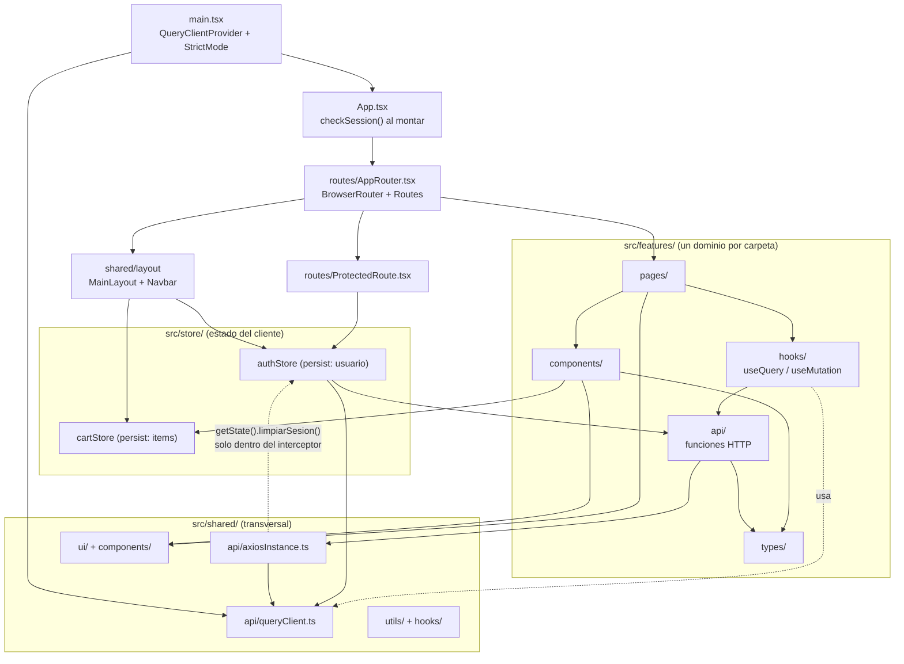
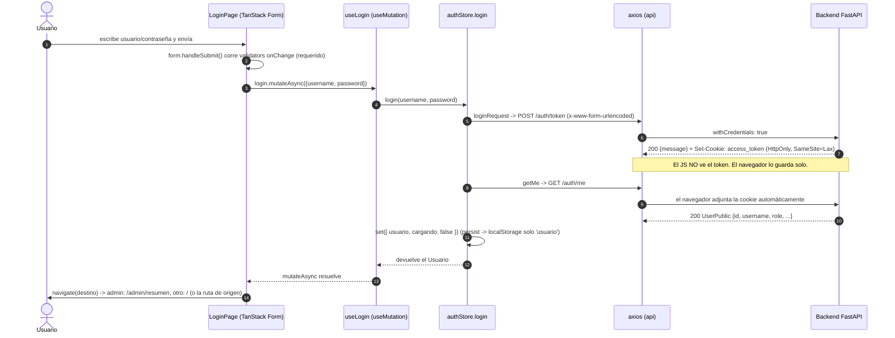
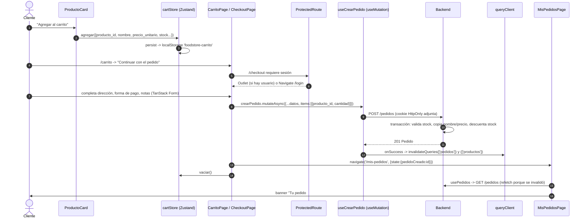

# 00 - Arquitectura del frontend: la foto grande

> Objetivo: que puedas pararte frente al profe y explicar **por qué** el frontend está armado así, no solo **cómo**. Primero los conceptos; el código es la prueba de que los entendiste.

## 1. Qué es el frontend de Food Store (en una frase)

Una SPA (Single Page Application) con **React 19 + TypeScript (strict) + Vite**, estilada con **Tailwind 4**, que consume la API REST del backend con **Axios**. Los datos que vienen del servidor los maneja **TanStack Query**, el estado propio del cliente (sesión y carrito) lo maneja **Zustand**, los formularios usan **TanStack Form**, las tablas del panel admin usan **TanStack Table** y la navegación **React Router** (`BrowserRouter`).

| Pieza | Versión fijada (`frontend/package.json`) | Para qué |
|-------|------------------------------------------|----------|
| react / react-dom | 19.3.1 | Interfaz |
| typescript | 6.0.3 | Tipado estricto |
| vite + @vitejs/plugin-react | 8.3.5 / 6.1.2 | Build y servidor de desarrollo |
| tailwindcss + @tailwindcss/vite | 4.3.3 | Estilos |
| @tanstack/react-query | 5.104.5 | Estado del **servidor** |
| @tanstack/react-form | 1.33.5 | Formularios con validación |
| @tanstack/react-table | 8.21.3 | Tablas del admin |
| react-router-dom | 7.18.4 | Rutas |
| zustand | 5.0.15 | Estado del **cliente** |
| axios | 1.20.0 | Cliente HTTP |

Todas las versiones están **fijas** (sin `^` ni `~`): la consigna dice "las versiones se fijan en `package.json`". Así dos máquinas distintas instalan exactamente lo mismo.

## 2. Arquitectura por features (por dominio, no por tipo)

### 2.1 El problema de organizar "por tipo"

La forma clásica de principiante es:

```
src/
  components/   (TODOS los componentes mezclados)
  hooks/        (TODOS los hooks)
  pages/
  api/
  types/
```

Funciona con 5 archivos. Con 80, para tocar "pedidos" tenés que abrir 5 carpetas distintas, y nada te dice qué pertenece a qué. Es como ordenar una casa por *tipo de objeto* (todos los cuchillos juntos, todos los cables juntos) en vez de por *ambiente* (cocina, living).

### 2.2 La solución: una carpeta por dominio

```
src/features/<dominio>/
  pages/        # pantalla de una ruta
  components/   # piezas de UI propias del dominio
  hooks/        # useQuery / useMutation del dominio
  api/          # funciones que llaman a los endpoints
  types/        # interfaces espejo de los schemas del backend
  utils/        # (solo pedidos) constantes y helpers del dominio
```

Las features **espejan los módulos del backend** (`auth`, `usuarios`, `categorias`, `productos`, `pedidos`). Si el profe te pregunta "¿dónde está la lógica de pedidos?", la respuesta es una sola carpeta: `src/features/pedidos/`. Y si mañana se borra una feature, se borra una carpeta.

Esto es *screaming architecture* (la estructura "grita" qué hace el sistema), el mismo principio que usás en el backend con `app/modules/<dominio>/`.

### 2.3 Qué va en cada carpeta raíz

| Carpeta | Qué contiene | Regla |
|---------|--------------|-------|
| `src/features/` | Un dominio por carpeta | Todo lo que sabe de negocio vive acá |
| `src/shared/` | Cosas transversales: `api/`, `ui/`, `components/`, `layout/`, `hooks/`, `utils/`, `types/` | Reutilizable en varias features |
| `src/store/` | `authStore.ts`, `cartStore.ts` | Estado **global del cliente** (Zustand) |
| `src/routes/` | `AppRouter.tsx`, `ProtectedRoute.tsx` | La tabla de rutas y la guarda |
| `src/App.tsx`, `src/main.tsx`, `src/index.css` | Punto de entrada | Montan providers, router y Tailwind |

**¿Por qué `store/` y `routes/` no están dentro de una feature?** Porque son **transversales**: la sesión la usan el Navbar, `ProtectedRoute`, el interceptor de Axios y varias páginas; el carrito lo usan el catálogo, el carrito y el checkout. Si vivieran en una feature, las otras tendrían que importar de adentro de ella.

### 2.4 Honestidad técnica: las dependencias no son 100 % "puras"

La teoría dice "`shared` no depende de las features". Verificado en el código, hay unos pocos acoplamientos pragmáticos (conviene que los conozcas por si preguntan):

- `shared/ui/BadgeEstado.tsx` importa el tipo `EstadoPedido` de `features/pedidos/types`.
- `shared/layout/Navbar.tsx` importa `ETIQUETA_ROL` de `features/auth/types` y los dos stores.
- `shared/api/axiosInstance.ts` importa `useAuthStore` de `store/` (para limpiar la sesión ante un 401).
- Entre features: `productos` usa `categorias` (hook y tipo); `pedidos` usa `productos` (`PRODUCTOS_KEY` para invalidar e `ImagenProducto`); `usuarios` reutiliza los tipos de `auth`.
- Hay un **import circular** real: `authStore` → `features/auth/api/auth` → `shared/api/axiosInstance` → `authStore`. Funciona porque `axiosInstance` solo usa `useAuthStore` *dentro de una función* (el interceptor), es decir, mucho después de que ambos módulos terminaron de evaluarse. Si lo usara a nivel de módulo (al importar), rompería. Ver `06-typescript-y-calidad.md`.

## 3. El mapa de carpetas y dependencias



Cómo leerlo: las flechas sólidas son "importa/usa". Las páginas orquestan; los hooks hablan con el servidor a través de `api/`; **toda** llamada HTTP pasa por la única instancia `axiosInstance`. La flecha punteada de `AxiosI` a `Auth` es el import circular que comentamos.

## 4. Estado del servidor vs estado del cliente (LA decisión central)

Esta es la separación que más pesa en la consigna ("SEPARACIÓN DEL ESTADO", p. 17) y la que más te van a preguntar.

| | Estado del **servidor** | Estado del **cliente** |
|---|---|---|
| Qué es | Datos que **viven en la base** y que el front solo *copia* | Datos que **solo existen en el navegador** |
| Ejemplos acá | Catálogo, categorías, pedidos, usuarios, resumen | Sesión (`usuario`), carrito (`items`) |
| Herramienta | **TanStack Query** | **Zustand** |
| Características | Asincrónico, puede quedar desactualizado (otro usuario lo cambia), puede fallar, es compartido | Síncrono, tuyo, no hay nadie más que lo modifique |
| Problemas que hay que resolver | Caché, loading/error, reintentos, invalidación, deduplicar pedidos, "stale" | Persistir entre recargas, compartir entre componentes |

### ¿Por qué no usar `useEffect + fetch + useState` para los datos del servidor?

Porque tendrías que reimplementar a mano (y mal) lo que TanStack Query ya resuelve:

1. **Estados de carga/error** en cada pantalla (`loading`, `error`, `data`): 3 `useState` + 1 `useEffect` por consulta.
2. **Carreras (race conditions)**: si el usuario cambia de página rápido, la respuesta vieja puede llegar después de la nueva y pisarla. Query descarta respuestas obsoletas por `queryKey`.
3. **Caché**: volver al catálogo no dispara otra llamada si el dato es fresco (`staleTime: 30_000`).
4. **Invalidación**: después de crear un pedido, decirle a Query "los productos y pedidos cambiaron, volvé a pedirlos" (una línea).
5. **Reintentos**, deduplicación, `keepPreviousData` para paginar sin parpadeo.

### ¿Por qué no meter el carrito en TanStack Query?

Porque el carrito **no es del servidor**: el backend no lo conoce hasta que se hace `POST /pedidos`. No hay endpoint que consultar ni nada que invalidar. Es estado local con persistencia (`localStorage`) → Zustand + `persist`.

### ¿Y el usuario de la sesión?

El **usuario** también viene del servidor (`GET /auth/me`), pero se guarda en Zustand porque es **estado global de sesión** que lo necesitan muchos componentes y *además lo escribe el cliente* (`login`, `logout`, `limpiarSesion`, y lo toca el interceptor de Axios **fuera de React**). Zustand permite `useAuthStore.getState()` desde cualquier archivo; los hooks de Query no. Es una decisión consciente y la consigna la pide: "authStore: Zustand + persist con partialize".

**Regla mnemotécnica:** si hay un endpoint que lo devuelve y puede cambiar sin que yo haga nada → Query. Si solo existe en este navegador → Zustand.

> La consigna lo resume así: *"Ningún componente obtiene datos del servidor con fetch dentro de useEffect; la única llamada en useEffect es checkSession al montar la aplicación."* Verificado con `rg useEffect src`: aparece en `App.tsx` (checkSession), `shared/hooks/useDebounce.ts` (un timer, no hace fetch) y `shared/ui/Modal.tsx` (listener de Escape). Ninguno trae datos.

## 5. Flujo de login (de punta a punta)



Errores: si `/auth/token` responde 401 (credenciales) o 400 (cuenta desactivada), `mutateAsync` rechaza, el `catch` de `onSubmit` lo ignora y `login.error` se muestra con `handleApiError` en `<AlertaError>`. El interceptor **no** trata el 401 de `/auth/token` como "sesión vencida" (está en `RUTAS_SIN_INTERCEPTAR`).

## 6. Flujo de checkout (de punta a punta)



Detalles que demuestran criterio:

- El front manda **solo** `producto_id` y `cantidad` por ítem. **No manda precios**: el backend toma el precio de la base y lo copia al detalle (RN-05). El total que ve el cliente en el checkout dice "estimado": `El total final lo calcula el sistema…`.
- Si el backend rechaza (400 stock insuficiente, 404 producto dado de baja), el `catch` de `confirmar` no navega ni vacía el carrito, y `crearPedido.error` se muestra arriba del formulario.
- Se invalidan **pedidos y productos**: crear un pedido descuenta stock, entonces el catálogo cacheado quedó desactualizado.

## 7. Por qué el token NUNCA lo lee JavaScript

El JWT viaja en una cookie con `HttpOnly` (backend: `app/modules/auth/router.py`, `httponly=True, samesite="lax", secure=False`; en producción con HTTPS iría `secure=True`).

| Opción | Quién puede leer el token | Riesgo |
|--------|---------------------------|--------|
| `localStorage` | Cualquier JS de la página | Un **XSS** (script inyectado) hace `localStorage.getItem('token')` y lo exfiltra |
| Cookie **HttpOnly** | Solo el navegador (se adjunta sola en cada request) | El JS —propio o inyectado— no puede leerla (`document.cookie` no la muestra) |

Por eso `authStore` guarda **solo** `usuario` (datos públicos: nombre, rol) y `partialize` lo garantiza. El token "pasa por el frontend" únicamente como un header `Cookie` que arma el navegador, nunca como un valor que el código vea. La consigna lo penaliza explícitamente en el criterio 4: *"Token en el cuerpo o en localStorage"* resta puntos.

Matiz honesto: HttpOnly protege contra **robo** del token por XSS, pero no contra que un XSS *haga requests* en tu nombre mientras la pestaña está abierta. Y al usar cookies aparece otro riesgo, **CSRF** (que otro sitio dispare requests con tu cookie). Se mitiga con `SameSite=Lax` (la cookie no viaja en POST cross-site) y con CORS restringido a un solo origen.

## 8. `withCredentials` y CORS con credenciales

Dos mitades que tienen que coincidir:

**Frontend** (`shared/api/axiosInstance.ts`):

```ts
export const api = axios.create({
  baseURL: import.meta.env.VITE_API_URL,
  withCredentials: true,
});
```

`withCredentials: true` le dice al navegador: "en requests **cross-origin** (5173 → 8000) adjuntá cookies y aceptá `Set-Cookie`". Sin esto, el login responde bien pero el navegador **descarta** la cookie y `/auth/me` da 401.

**Backend** (`backend/app/main.py`):

```python
app.add_middleware(CORSMiddleware,
    allow_origins=[settings.FRONTEND_ORIGIN],   # "http://localhost:5173"
    allow_credentials=True, ...)
```

Reglas del navegador: con credenciales, el servidor **no puede** responder `Access-Control-Allow-Origin: *`; tiene que nombrar el origen exacto y mandar `Access-Control-Allow-Credentials: true`. Por eso `FRONTEND_ORIGIN` es una variable de entorno específica.

¿Por qué `SameSite=Lax` funciona si son puertos distintos? Porque "site" = esquema + dominio registrable (`localhost`); el **puerto no cuenta** para "same-site". `localhost:5173` y `localhost:8000` son *cross-origin* (CORS aplica) pero *same-site* (la cookie Lax viaja).

`VITE_API_URL` (ej. `http://localhost:8000/api/v1`) se define en `frontend/.env` (existe `.env.example` de 42 bytes). Se tipa en `src/vite-env.d.ts` y se lee con `import.meta.env`. Las variables que empiezan con `VITE_` quedan **expuestas en el bundle público**: nunca pongas secretos ahí.

## 9. Resumen por decisión: qué lo exige, qué elegimos nosotros y qué descartamos

Para el oral conviene separar **"lo pide la consigna"** (se defiende citando la página) de **"lo decidimos nosotros"** (se defiende con el motivo técnico).

| Decisión | ¿Quién la impone? | Por qué (motivo técnico) | Alternativa descartada |
|----------|-------------------|--------------------------|------------------------|
| Features por dominio | Consigna (pág. 17: "se organiza por dominios") | Cohesión: todo lo de "pedidos" en un lugar; espeja el backend | Carpetas por tipo (`components/`, `hooks/`...): para tocar una funcionalidad abrís 5 carpetas |
| `shared/` sin lógica de negocio | Consigna (pág. 18: "Transversal, sin lógica de negocio") | Reutilizar UI sin acoplarla a un dominio | Copiar componentes en cada feature |
| TanStack Query para el servidor | Consigna (pág. 17, "Separación del estado") | Caché, loading/error, invalidación, reintentos, sin race conditions | `useEffect + fetch + useState`: sin caché, sin dedupe, carreras |
| Zustand para sesión y carrito | Consigna (pág. 17 y 20) | Estado del cliente, accesible también fuera de React (`getState()`), con `persist` | Context/Redux: Context no se lee desde el interceptor; Redux es más boilerplate |
| Un solo `axiosInstance` | Consigna (pág. 18) | Un lugar para `baseURL`, cookies y manejo de 401 | `axios`/`fetch` suelto en cada función |
| Cookie HttpOnly, nada en `localStorage` | Consigna (criterio 4) | El JS no puede leer el token: un XSS no lo roba | JWT en `localStorage` (resta puntos y es robable por XSS) |
| `partialize` guarda solo `usuario` | Consigna (pág. 20) | `cargando` debe arrancar en `true`; nunca el token | `persist` de todo el estado |
| `checkSession` único `useEffect` con API | Consigna (pág. 17) | Inicializar la sesión global al montar | `fetch` en `useEffect` en cada página |
| Interceptor excluye `/auth/token` y `/auth/me` | Consigna (pág. 20) | En esas rutas el 401 es una respuesta esperada (credencial mala / sin sesión) | Tratar todo 401 igual: el login se recargaría solo y las rutas públicas redirigirían |
| `window.location.assign` en el interceptor | Nuestra (consigna: "el propio interceptor o ProtectedRoute") | El interceptor está fuera de React: no hay `useNavigate`; con `BrowserRouter` no hay objeto `router` importable; la recarga además resetea el estado | `navigate()` (imposible fuera de un componente) |
| `queryClient` sin reintentos en 4xx | Nuestra | Un 4xx es definitivo; solo red/5xx merecen reintento | Default de Query (3 reintentos aun en 4xx) |
| `queryClient` singleton exportado | Nuestra (la consigna pide "instancia única") | Logout e interceptor limpian la caché fuera de React | Crearlo dentro de `App` |
| `logout` limpia store + caché + carrito | Nuestra (consigna pide "limpia el authStore") | Que el próximo usuario del navegador no herede datos | Solo limpiar el store |
| `cargando` arranca en `true` | Nuestra (necesaria por la consigna del indicador) | Distinguir "no sé" de "no hay sesión" | Arrancar en `false`: redirect falso en cada recarga |
| `ProtectedRoute` | Consigna (pág. 20) | Solo UX; la autorización real es del backend | Confiar solo en el front |
| `DataTable` genérica dueña de su estado | Nuestra (la consigna pide TanStack Table cliente) | Una tabla tipada para 4 entidades, sin `any` | Una `<table>` por pantalla |
| `Modal` controlado con listener de Escape | Nuestra | Quien lo usa decide qué significa cerrar; el efecto se limpia | `window.confirm`, librería de modales |
| `useDebounce` | Nuestra | Un request por búsqueda, no por tecla | Filtrar en cada `onChange` |
| TypeScript strict sin `any` | Consigna (pág. 17: TS 5.9+; `pnpm build` verifica los tipos) y criterio de calidad | El compilador detecta el desfasaje con el backend | `any` / casts |

## 10. El import circular `authStore` <-> `axiosInstance`

```
authStore.ts -> features/auth/api/auth.ts -> shared/api/axiosInstance.ts -> authStore.ts
```

- **Por qué existe:** el store necesita llamar a la API (login, logout, `/auth/me`), y el interceptor de la API necesita limpiar el store cuando la sesión vence. Ambos lados se necesitan.
- **Por qué funciona:** en ESM un ciclo solo rompe si usás el valor *mientras el módulo se está evaluando*. Acá cada lado usa al otro **dentro de funciones** (acciones del store, callback del interceptor) que se ejecutan mucho después de cargados los módulos.
- **Cuándo se rompe:** si `axiosInstance.ts` lee `useAuthStore` a nivel de módulo, o si `authStore` ejecuta una llamada a la API al crearse.
- **Cómo lo arreglaría:** invertir la dependencia. `axiosInstance` exporta `registrarManejadorSesionVencida(fn)` y no importa el store; `authStore.ts` (o `main.tsx`) registra `() => { limpiarSesion(); queryClient.clear(); }`. Queda una sola dirección de dependencia: `authStore -> axiosInstance`. Detalle en `02-store-y-rutas.md`.
- **Respuesta para el oral:** "Conozco el ciclo y lo dejé porque es seguro mientras el store se use de forma diferida; si el proyecto creciera lo resolvería con un callback registrado."

## 11. Preguntas rápidas de "por qué" (respuestas de una línea)

- **¿Por qué TanStack Query y Zustand los dos?** Porque son dos tipos de estado: el del servidor (catálogo, pedidos: puede quedar viejo, se cachea e invalida) y el del cliente (sesión, carrito: solo existe en el navegador). La consigna los separa en la pág. 17.
- **¿Por qué el token está en una cookie HttpOnly?** Para que ningún JavaScript, ni propio ni inyectado, pueda leerlo. En `localStorage` un XSS se lo lleva.
- **¿Por qué no hay `useEffect` con fetch?** Porque la consigna lo prohíbe y porque Query resuelve caché, carreras y reintentos. La excepción es `checkSession`, que inicializa estado global.
- **¿Por qué `ProtectedRoute` no es seguridad?** Porque el código del front lo controla el usuario. La seguridad es `require_role` en el backend.
- **¿Por qué la paginación del admin es del cliente y la del catálogo del servidor?** La consigna lo define: el panel pide `limit=100` y pagina en memoria con TanStack Table; el catálogo puede ser grande y pagina con `skip = página × limit`.
